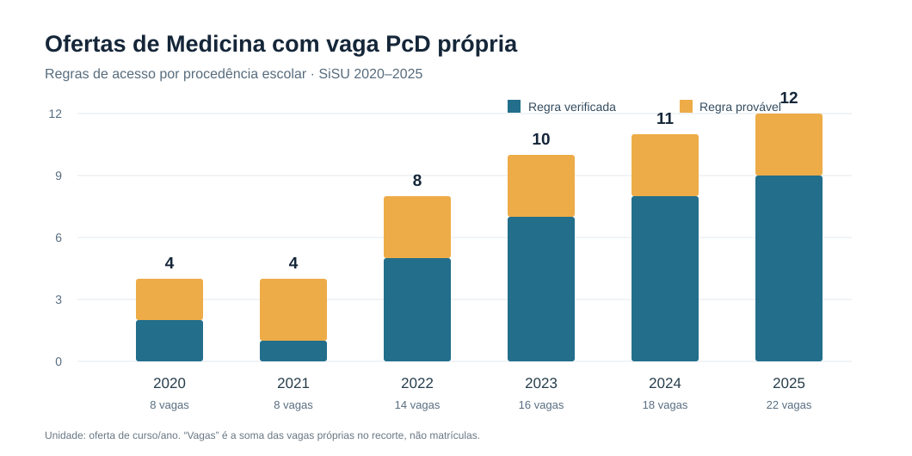
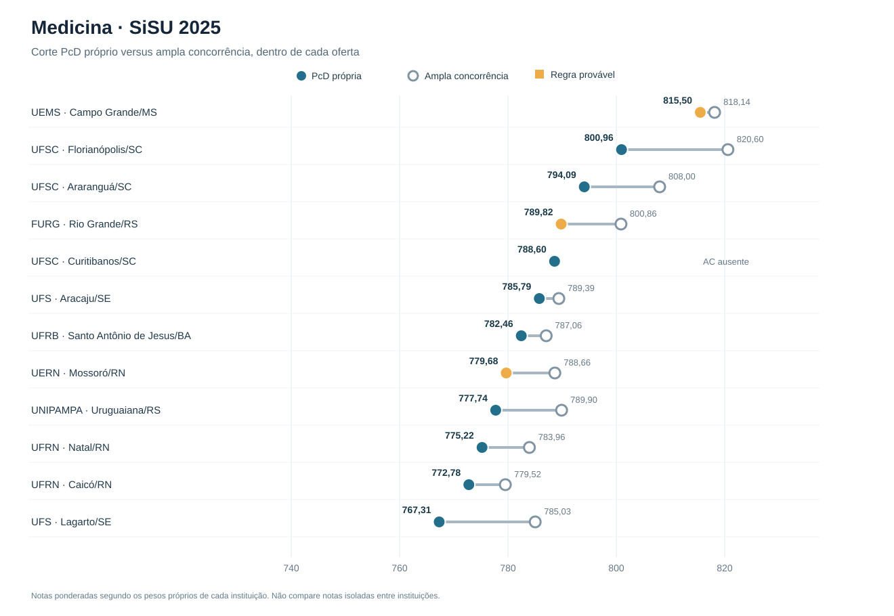

# Atlas visual — Medicina e vagas PcD

> **Recorte:** vagas PcD próprias de Medicina; distingue procedência escolar privada confirmada, provável ou sem verificação. **Não confundir com cotas legais PcD restritas a egressos da escola pública.**

[**Abrir painel interativo (arquivo HTML)**](./painel.html) · [Dados primários organizados no repositório](../README.md)

## 1. Evolução de ofertas (2020–2025)

| Ano | Ofertas totais de Medicina | Regra verificada | Regra provável | Vagas nas ofertas acessíveis ou prováveis |
|---:|---:|---:|---:|---:|
| 2020 | 88 | 2 | 2 | 8 |
| 2021 | 78 | 1 | 3 | 8 |
| 2022 | 88 | 5 | 3 | 14 |
| 2023 | 88 | 7 | 3 | 16 |
| 2024 | 92 | 8 | 3 | 18 |
| 2025 | 89 | 9 | 3 | 22 |

**Nota metodológica:** contagens de ofertas não representam número de pessoas aprovadas; a quantidade de vagas soma os lugares PcD próprios dos cursos correspondentes. A situação de elegibilidade depende do edital de cada processo.

## 2. Notas de corte comparadas — Medicina SiSU 2025

| Instituição | Município (UF) | Vagas PcD próprias | Corte PcD | Corte ampla concorrência | Diferença PcD–AC | Regra de escola particular |
|:--|:--|--:|--:|--:|--:|:--|
| UFS | Lagarto (SE) | 1 | **767,31** | 785,03 | -17,72 | Verificada |
| UFRN | Caicó (RN) | 1 | **772,78** | 779,52 | -6,74 | Verificada |
| UFRN | Natal (RN) | 1 | **775,22** | 783,96 | -8,74 | Verificada |
| UNIPAMPA | Uruguaiana (RS) | 2 | **777,74** | 789,90 | -12,16 | Verificada |
| UERN | Mossoró (RN) | 4 | **779,68** | 788,66 | -8,98 | Provável |
| UFRB | Santo Antônio de Jesus (BA) | 1 | **782,46** | 787,06 | -4,60 | Verificada |
| UFS | Aracaju (SE) | 1 | **785,79** | 789,39 | -3,60 | Verificada |
| UFSC | Curitibanos (SC) | 2 | **788,60** | — | — | Verificada |
| FURG | Rio Grande (RS) | 4 | **789,82** | 800,86 | -11,04 | Provável |
| UFSC | Araranguá (SC) | 2 | **794,09** | 808,00 | -13,91 | Verificada |
| UFSC | Florianópolis (SC) | 2 | **800,96** | 820,60 | -19,64 | Verificada |
| UEMS | Campo Grande (MS) | 1 | **815,50** | 818,14 | -2,64 | Provável |

**Interpretação correta:** a nota PcD deve ser comparada com a ampla concorrência **do mesmo campus e ano**, dado que pesos e bônus variam entre universidades. A ausência de corte AC para UFSC Curitibanos é uma informação faltante, não um zero.

## 3. Registros adicionais de 2026

| Local | Modalidade PcD própria acessível à escola privada | Corte 2025 | Corte 2026 | Tipo de fonte 2026 |
|:--|:--|--:|--:|:--|
| UFS Aracaju | V1 (qualquer procedência escolar) | 785,79 | 803,39 | Documento institucional indicado no banco |
| UFS Lagarto | V1 (qualquer procedência escolar) | 767,31 | 788,49 | Documento institucional indicado no banco |

O arquivo [`notas_2026_complementares.csv`](../data/manual/notas_2026_complementares.csv) reúne outros resultados de 2026, inclusive UFPI e UESPI. **As vagas PcD por cotas da escola pública não foram reclassificadas como elegíveis à escola particular.** O Edital UFPI 06/2026 utiliza EPC, grandeza que não deve ser fundida indiscriminadamente com as notas do SiSU.

## 4. Editais de 2027 e jurisprudência

O painel HTML reúne **16 processos seletivos** e **26 referências jurisprudenciais**, com situação das inscrições registrada em 28/10/2026, critério de procedência escolar, tipo de fonte e links. As referências judiciais estão separadas por níveis de verificação; decisões não localizadas não constituem precedentes confirmados.

## 5. Como visualizar

- **No próprio GitHub:** abra este arquivo Markdown para ver os gráficos SVG e as tabelas.
- **Como painel navegável:** baixe [`painel.html`](./painel.html) e abra-o no navegador. Os dados estão embutidos, sem carregamento remoto.
- **Como site hospedado:** o proprietário do repositório pode publicar a pasta `/docs` com GitHub Pages; a configuração de Pages deve ser realizada nas configurações do repositório. A publicação não é presumida ativa.

## Fontes, qualidade e privacidade

Todos os números acima foram derivados dos CSVs versionados neste pull request. A base documenta **523 ofertas em 2020–2025**, **82 linhas PcD próprias** e uma checagem limitada de **20/20 notas da UFS**. O dado histórico se refere à **chamada regular**. Este painel não determina automaticamente condição PcD, direito a matrícula ou nota de corte para 2027. Nenhum candidato é identificado neste documento.
