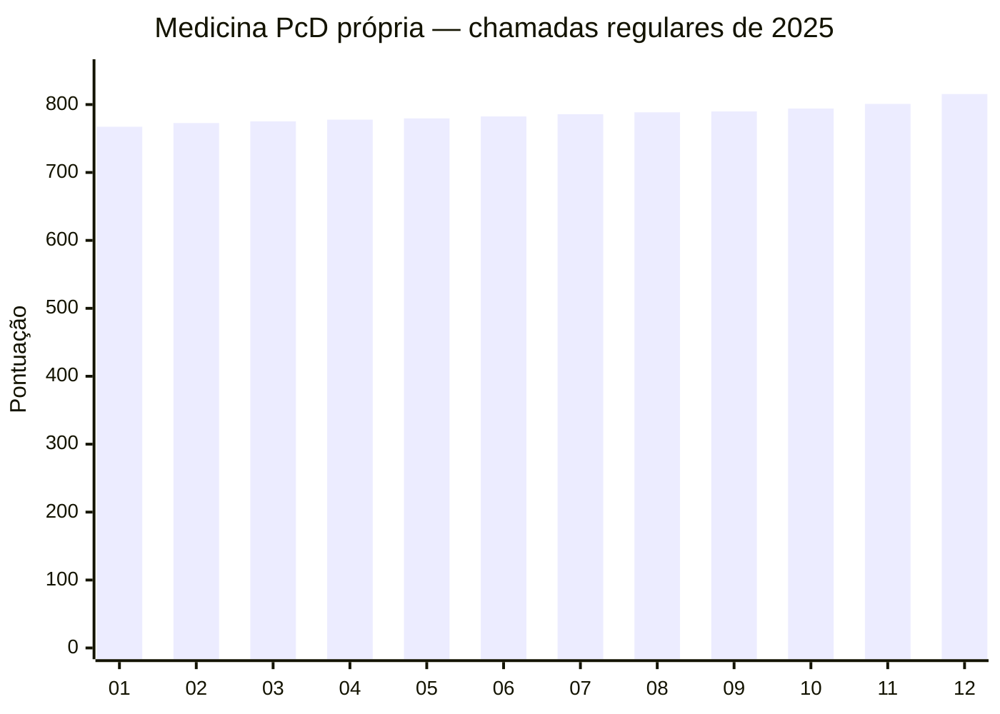
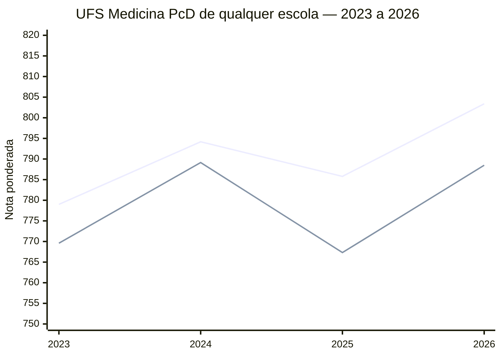
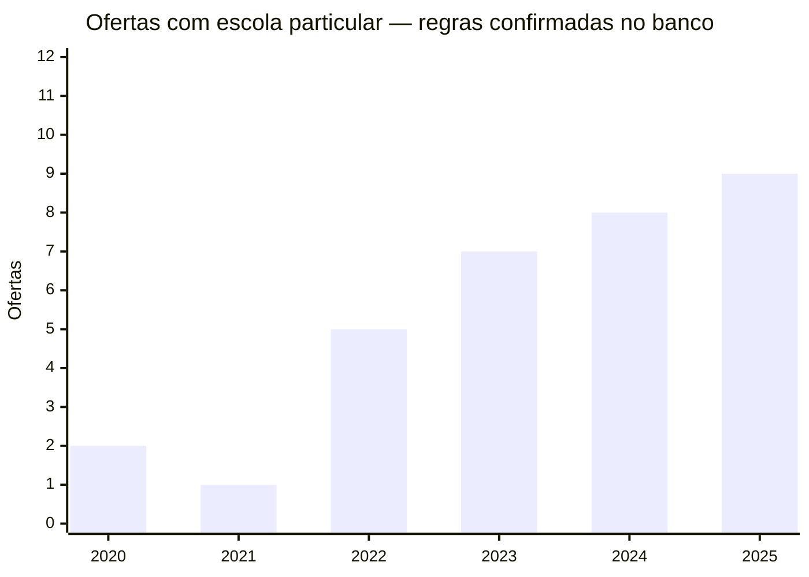

# Visualização de notas — Medicina PcD

> **Escopo:** vagas PcD próprias de Medicina na chamada regular do SiSU, 2020–2025; recorte de ofertas cuja regra é compatível ou provavelmente compatível com ensino médio em escola particular. **Não há resultados da ampla concorrência nesta página e não há nomes de candidatos.** Dados derivados de [sisu-data](https://github.com/gabekanegae/sisu-data), organizados pelo [PR nº 6](https://github.com/moonvives/ok/pull/6). A verificação documental das regras varia por universidade e ano.

## Painel de indicadores

| Indicador | Valor | Observação |
|---|---:|---|
| Todas as ofertas de Medicina na base SiSU (2020–2025) | 523 | Universo do repositório; não são todas PcD |
| Ofertas de Medicina em modalidade PcD própria (2020–2025) | 82 | Inclui ofertas com restrição a escola pública |
| Ofertas PcD próprias em 2025 | 16 | Com ou sem escola privada |
| Ofertas PcD 2025 potencialmente acessíveis a escola particular | 12 | 9 verificadas no banco; 3 prováveis |
| Vagas PcD nessas 12 ofertas em 2025 | 22 | Soma das vagas publicadas por modalidade, não número de matriculados |

## Gráfico 1 — Pontuação PcD própria em 2025, por oferta

Para preservar a leitura em telas pequenas, o eixo usa a classificação **01–12**, detalhada na tabela logo abaixo. As notas são as notas de classificação, geralmente **ponderadas**, e os pesos variam conforme a instituição. Portanto, não são equivalentes à média aritmética simples do ENEM.

| ID | Instituição e cidade | Estado | Vagas PcD | Nota de classificação | Verificação da regra para escola particular |
|---|---|:---:|---:|---:|---|
| 01 | UFS — Lagarto | SE | 1 | **767,31** | Confirmada no banco |
| 02 | UFRN — Caicó | RN | 1 | **772,78** | Confirmada no banco |
| 03 | UFRN — Natal | RN | 1 | **775,22** | Confirmada no banco |
| 04 | UNIPAMPA — Uruguaiana | RS | 2 | **777,74** | Confirmada no banco |
| 05 | UERN — Mossoró | RN | 4 | **779,68** | Provável; reconfirmar |
| 06 | UFRB — Santo Antônio de Jesus | BA | 1 | **782,46** | Confirmada no banco |
| 07 | UFS — Aracaju | SE | 1 | **785,79** | Confirmada no banco |
| 08 | UFSC — Curitibanos | SC | 2 | **788,60** | Confirmada no banco |
| 09 | FURG — Rio Grande | RS | 4 | **789,82** | Provável; reconfirmar |
| 10 | UFSC — Araranguá | SC | 2 | **794,09** | Confirmada no banco |
| 11 | UFSC — Florianópolis | SC | 2 | **800,96** | Confirmada no banco |
| 12 | UEMS — Campo Grande | MS | 1 | **815,50** | Provável; reconfirmar |

## Gráfico 2 — Evolução da nota PcD na UFS (2023–2026)

Aqui há dois campi da **mesma instituição com a mesma estrutura de pesos**, permitindo uma comparação temporal mais consistente que o ranking nacional. As notas de 2026 vêm do documento oficial de chamada regular incluído em `data/manual/notas_2026_complementares.csv`.

**Linhas na ordem do gráfico:** Aracaju (primeira); Lagarto (segunda).

| Ano | Aracaju — PcD própria | Lagarto — PcD própria |
|---:|---:|---:|
| 2023 | 779,00 | 769,59 |
| 2024 | 794,18 | 789,15 |
| 2025 | 785,79 | 767,31 |
| 2026 | 803,39 | 788,49 |

Fonte 2023–2025: [tabela histórica do PR](https://github.com/moonvives/ok/blob/claude/banco-pcd-medicina/data/gerado/sisu_medicina_pcd_propria_2020_2025.csv). Fonte 2026: [dados complementares](https://github.com/moonvives/ok/blob/claude/banco-pcd-medicina/data/manual/notas_2026_complementares.csv) e [chamada regular UFS 2026](https://sisu.ufs.br/uploads/content_attach/path/42599/_CHAMADA_REGULAR__SISU-2026_2026-01-30.pdf).

## Gráfico 3 — Ofertas PcD próprias com escola privada permitida ou provável

O gráfico mostra apenas ofertas cuja elegibilidade de escola particular consta como **sim** ou **provável sim** no banco. É uma contagem de ofertas campus/ano; não de vagas ou pessoas. As categorias foram separadas por qualidade da verificação.

| Ano | Regra verificada no banco | Regra provável | Total potencial |
|---:|---:|---:|---:|
| 2020 | 2 | 2 | **4** |
| 2021 | 1 | 3 | **4** |
| 2022 | 5 | 3 | **8** |
| 2023 | 7 | 3 | **10** |
| 2024 | 8 | 3 | **11** |
| 2025 | 9 | 3 | **12** |

## Como interpretar as notas

- **PcD própria** significa uma modalidade instituída pela universidade; nem toda modalidade própria permite ensino médio particular. A coluna de verificação é indispensável.
- **Nota de corte** da chamada regular não é necessariamente a nota do último matriculado depois das listas de espera.
- **Média sem pesos não disponível:** estes arquivos exibem nota de classificação. Não se deve inverter a fórmula para inventar média simples do ENEM.
- **Ano de ingresso e regras futuras:** o histórico de 2020–2025 não substitui o edital de 2027.
- **Validação:** as notas históricas foram obtidas de base derivada de informações do SiSU; o PR documenta 20 comparações coincidentes com listas oficiais da UFS, sem auditoria oficial integral das 523 ofertas.

## Arquivos de apoio

- [Base completa de Medicina PcD própria 2020–2025](https://github.com/moonvives/ok/blob/claude/banco-pcd-medicina/data/gerado/sisu_medicina_pcd_propria_2020_2025.csv)
- [Notas de 2026 e respectivos links](https://github.com/moonvives/ok/blob/claude/banco-pcd-medicina/data/manual/notas_2026_complementares.csv)
- [Processos e editais de 2026–2027](https://github.com/moonvives/ok/blob/claude/banco-pcd-medicina/data/manual/editais_pcd_medicina.csv)
- [Regras de inclusão por instituição](https://github.com/moonvives/ok/blob/claude/banco-pcd-medicina/data/manual/regras_pcd_proprias.csv)
- [Conferência amostral de notas UFS](https://github.com/moonvives/ok/blob/claude/banco-pcd-medicina/data/gerado/validacao_ufs.csv)
